# Joseph Edwards

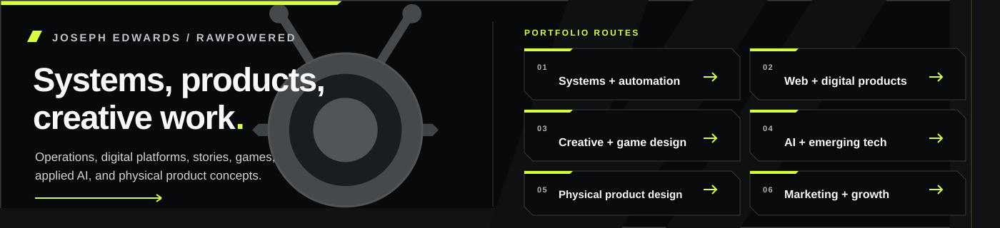

I build systems and products that help teams run work and serve customers. My experience spans CRM and API delivery, workflow automation, web products, construction and solar operations, and creative development in game design, storytelling, and UI/UX.

I am open to roles in business systems, IT and operations, automation, web and product delivery, and creative technology. I am especially interested in challenging work across space, defense, AI, industrial technology, construction, and solar.

 

<h2 id="find-your-route"> Find your route</h2>

Five starting points make it easier to reach the work that fits your opening. Project pages identify their current status and available evidence.

<table>
<tr>
<td width="50%" valign="top">
<h3 id="systems-it-automation"><a href="https://github.com/RawPowered/Systems-Administration-Portfolio">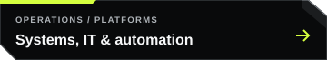</a></h3>

<a href="https://github.com/RawPowered/Systems-Administration-Portfolio">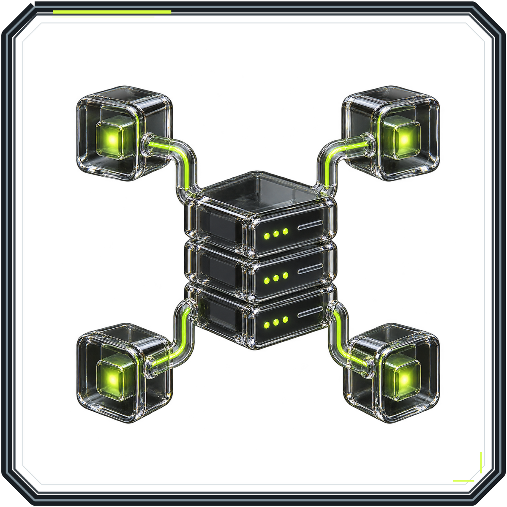</a>

Systems administration, CRM, workflow automation, APIs, integrations, and support operations.

  

</td>
<td width="50%" valign="top">
<h3 id="web-digital-products"></h3>

Responsive desktop and mobile experiences, WordPress, multisite, LMS, and product interfaces.

 

</td>
</tr>
<tr>
<td width="50%" valign="top">
<h3 id="creative-interactive"></h3>

<a href="https://github.com/RawPowered/Game-Design-Portfolio">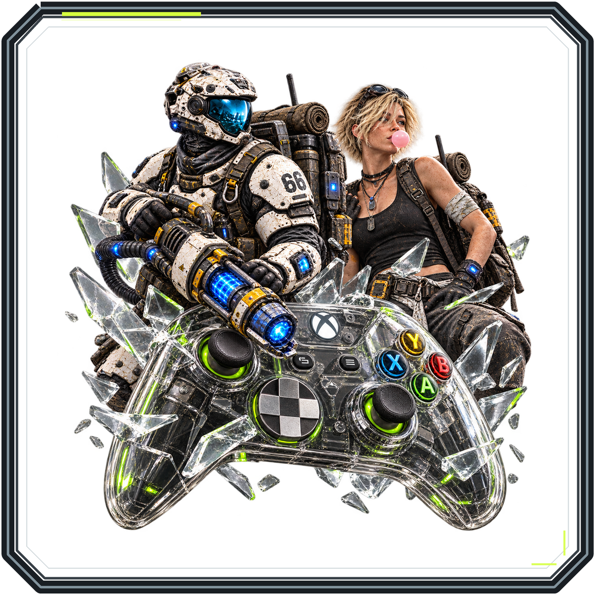</a>

Show and screenplay writing, illustration, UI/UX, game stories, player loops, systems, and economies. Game implementation examples use Godot and Unreal Engine.

  <a href="https://github.com/RawPowered/Crawl-Brawl">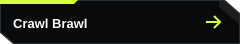</a>

</td>
<td width="50%" valign="top">
<h3 id="ai-emerging-technology"></h3>

<a href="https://github.com/RawPowered/RawMarkets">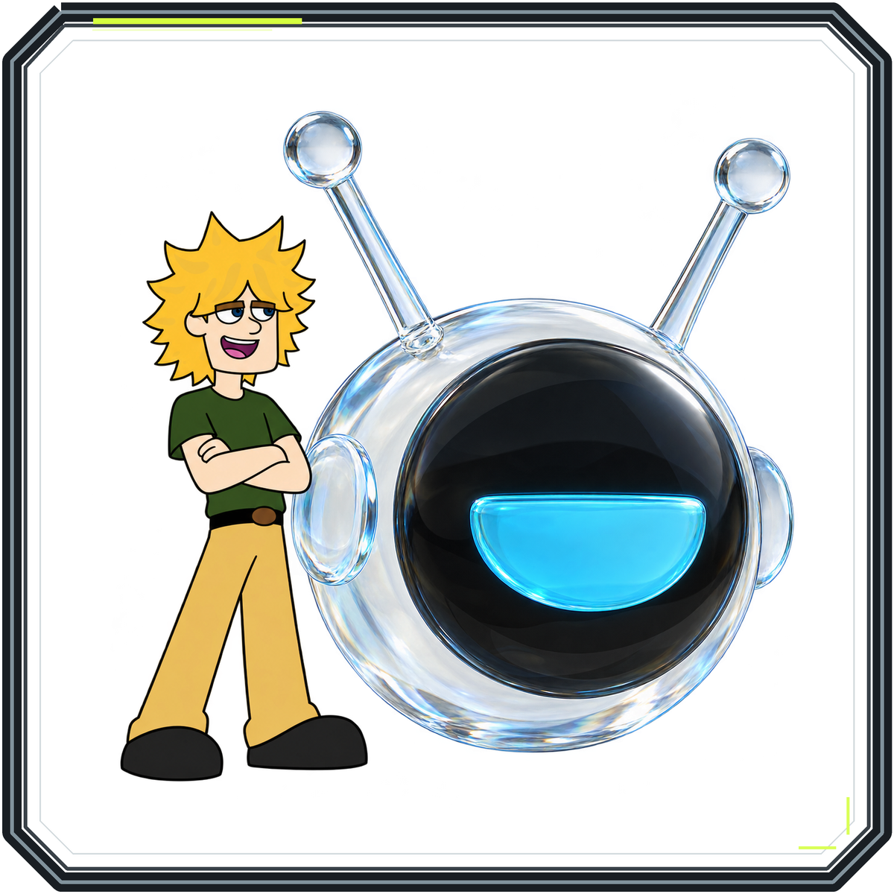</a>

AI-assisted products, model integration, research and content assessment, and image or video development. I describe model use and project status where shown.

     

</td>
</tr>
<tr>
<td colspan="2" valign="top">
<h3 id="marketing-growth"></h3>

<a href="https://github.com/RawPowered/Marketing-SEO-Performance-Portfolio">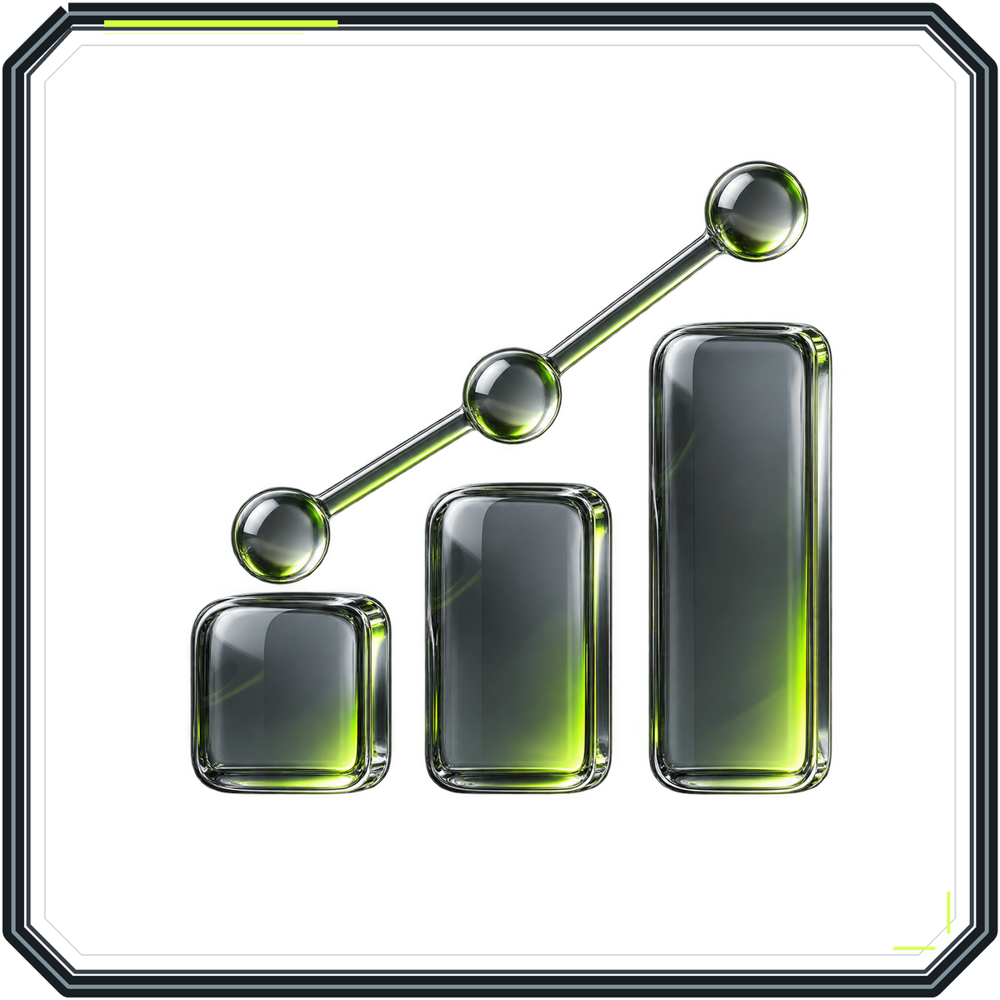</a>

Organic search, content, and social media work across organic and paid channels.

</td>
</tr>
<tr>
<td colspan="2" valign="top">
<h3 id="physical-products"><a href="docs/PROJECT-SHOWCASES.md#physical-product-design">Engineering and product design</a></h3>

Physical product concepts spanning product engineering, design, branding, and supporting digital experiences.

 

</td>
</tr>
</table>

<strong>Looking for another fit?</strong> Start with the project closest to the work, then follow its design, engineering, or operations evidence.

<h2 id="featured-projects"> Selected work</h2>

<h3 id="systems-and-digital-products">Systems and digital products</h3>

<table>
<tr>
<td width="50%" valign="top">
<h3 id="flow-fountain"><a href="https://github.com/RawPowered/flow-fountain-for-crms">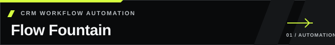</a></h3>

Self-hosted workflow authoring, integration controls, execution review, and audit context.

<strong>Source preview:</strong> built first for GoHighLevel/LeadConnector. Each additional CRM needs its own adapter and configuration.

  <a href="https://github.com/RawPowered/flow-fountain-for-crms/actions/workflows/ci.yml">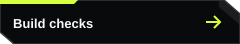</a>

</td>
<td width="50%" valign="top">
<h3 id="305ugc-suite"><a href="https://github.com/RawPowered/305UGC-Showcase">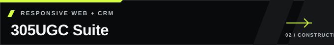</a></h3>

Responsive web design, guided project intake, and a WordPress and Zoho CRM integration architecture.

<strong>Portfolio project:</strong> public site captured; full operational acceptance remains pending.

  

</td>
</tr>
<tr>
<td width="50%" valign="top">
<h3 id="powerportals"><a href="https://github.com/RawPowered/PowerPortals-Showcase">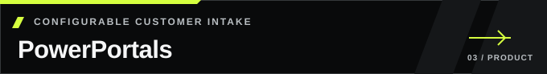</a></h3>

Configurable intake, customer and team workspaces, and Zoho companion widgets.

<strong>Private validation:</strong> public tours use fictional data; source and commercial installation are reviewed separately.

  

</td>
<td width="50%" valign="top">
<h3 id="osint-dive-deep"></h3>

Research studio, web API, provider adapters, and job-scoped worker architecture.

<strong>Released source:</strong> hosted services and optional providers need operator configuration.

  

</td>
</tr>
</table>

<h3 id="creative-and-interactive-work">Creative and interactive work</h3>

<table>
<tr>
<td width="33%" valign="top">
<h3 id="civilian66-game-design"></h3>

Story and world direction, character work, progression case studies, and a proposed Bloopi plush line.

<strong>Status:</strong> independent game in development. The public project page is a curated showcase; its Unreal Engine clip is an early proof of play, not a public standalone release.

<a href="https://github.com/RawPowered/Game-Design-Portfolio">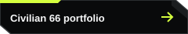</a> <a href="https://github.com/RawPowered/Game-Design-Portfolio#selected-design-work">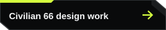</a> 

</td>
<td width="33%" valign="top">
<h3 id="crawl-brawl">Crawl Brawl</h3>

Playable Windows beta and Godot project. Digging, resource collection, base building, defense, and combat form the current play loop.

<a href="https://github.com/RawPowered/Crawl-Brawl">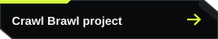</a>  

</td>
<td width="33%" valign="top">
<h3 id="earth-to-jay">Earth To Jay</h3>

Original animated-adventure concept with show planning, character writing, screenplay work, and scripted voice performance.

<strong>Visual development:</strong> AI-assisted storyboard concepts, identified as development images.

 

</td>
</tr>
</table>

<h3 id="ai-and-model-work">AI and model work</h3>

     

RawMarkets is a market research desktop product in progress with data ingestion, portfolio tools, and an AI copilot in its public product overview. <strong>RawGraded Studio</strong> combines local-first card capture, image analysis, deterministic grading math, and optional AI evidence passes. <strong>LuxuryCatalog</strong> uses Gemini image models to turn line-art door designs into catalog imagery and supports batch processing, PDF export, and PDF-based recovery. <strong>XRepHunter</strong> is a browser-extension prototype for social content assessment, with AI-image signals and account or feed analysis; its showcase describes the prototype without publishing its working source. I identify model use and project status alongside each example.

<h3 id="physical-product-work">Physical product work</h3>

Product concepts that bring industrial design, engineering details, brand systems, and companion experiences together.

 

<h3 id="historical-web-and-education-work">Earlier web and education work</h3>

Earlier work includes WordPress multisite and LMS development through TactiveLearning and cannabisuniversity.org. A surviving public archive shows a 2013 Gravity Forms question posted under the TactiveLearning name, supporting a historical WordPress and form-work connection. I recall that TactiveLearning served Western Governors University cohorts and reached more than 10,000 learners over its lifetime; the surviving public record does not independently verify the university relationship or learner count.

<h2 id="operational-experience"> Operational experience</h2>

At Expert Solar, I administered business systems, took over outstanding CRM delivery requests, and supported the Salesforce-to-Zoho transition. My reported outcome was a reduction of approximately **$20K/month** in external development expense after delivery moved in-house.

[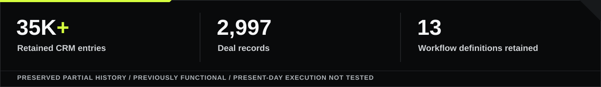](docs/EXPERT-SOLAR.md)

The legacy Zoho account preserves partial history of a previously functional system. Its full historical automation setup is unavailable for review. The savings figure is my reported business outcome, separate from the retained CRM records. [Review the evidence and limits](docs/EXPERT-SOLAR.md) · [SaaS administration, migration, and Apple MDM](docs/BACKGROUND.md)

<h2 id="security-privacy"> Security, privacy, and engineering judgment</h2>

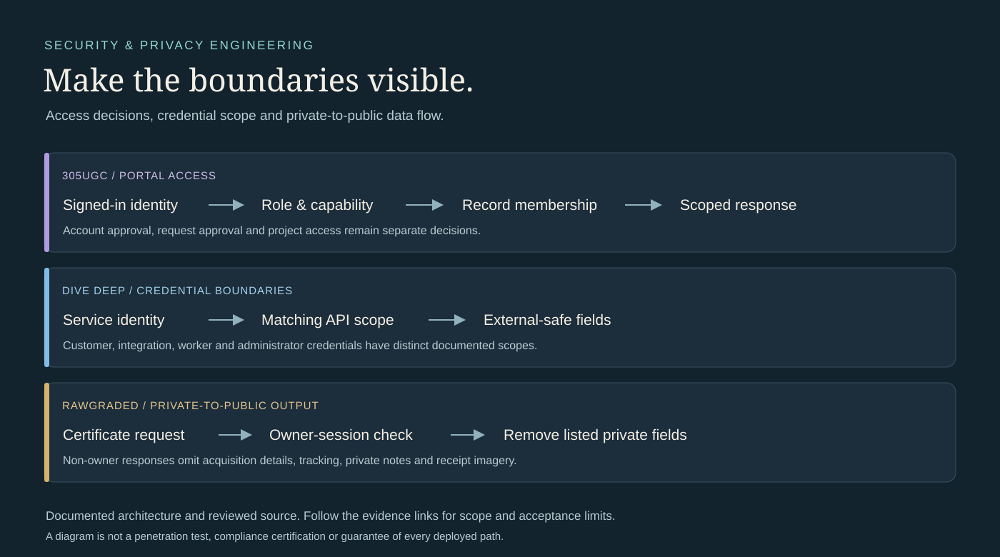

I separate sign-in from record access, keep integration credentials server-side, and define which fields an endpoint may return. [Review the diagrams and verification scope](docs/SECURITY-AND-PRIVACY.md).

<h2 id="how-i-work"> How I work</h2>

I map the process, decision authority, and data boundaries first. I design for failure and recovery, then document the implementation and the evidence it supports. I use Cursor and Codex to speed development; I define architecture, review code, debug failures, and set release scope. [Design review](docs/DESIGN.md) · [Engineering walkthrough](docs/ENGINEERING.md).

**Tools and methods:** Zoho CRM · Salesforce-to-Zoho migration · REST APIs · workflow automation · WordPress · responsive and mobile UX · technical SEO · TypeScript/JavaScript · Python · PHP · SQL · Node.js · React · Godot · Unreal Engine · Microsoft 365 · Google Workspace · GitHub Actions · AI model integration and evaluation.

<h2 id="more-tools"> More tools</h2>

<table>
<tr>
<td width="50%" valign="top"></td>
<td width="50%" valign="top"><a href="https://github.com/RawPowered/OrphanHunter">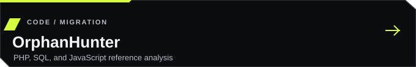</a></td>
</tr>
<tr>
<td width="50%" valign="top"><a href="https://github.com/RawPowered/RawInvestor">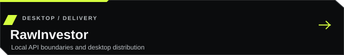</a></td>
<td width="50%" valign="top"><a href="https://github.com/RawPowered/RawGraded">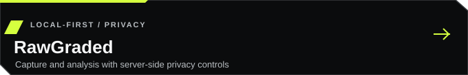</a></td>
</tr>
</table>

<a href="https://github.com/RawPowered?tab=repositories">Browse all public repositories</a>

<h2 id="before-we-meet"> Before we meet</h2>

- **Where might I contribute?** Systems and IT operations, business platforms, web and product delivery, marketing, game design, and creative development. My experience spans construction, solar, enterprise systems, and independent products. I am especially interested in space, defense, and AI teams.
- **What can you review?** Public source, playable work, demonstrations, design material, selected historical records, and project status notes.
- **How should we start?** Follow the route closest to the opening. I can walk through the problem, my part in the work, the decisions, and the evidence that remains available.

[Connect on LinkedIn](https://www.linkedin.com/in/josephedwardscto/)
