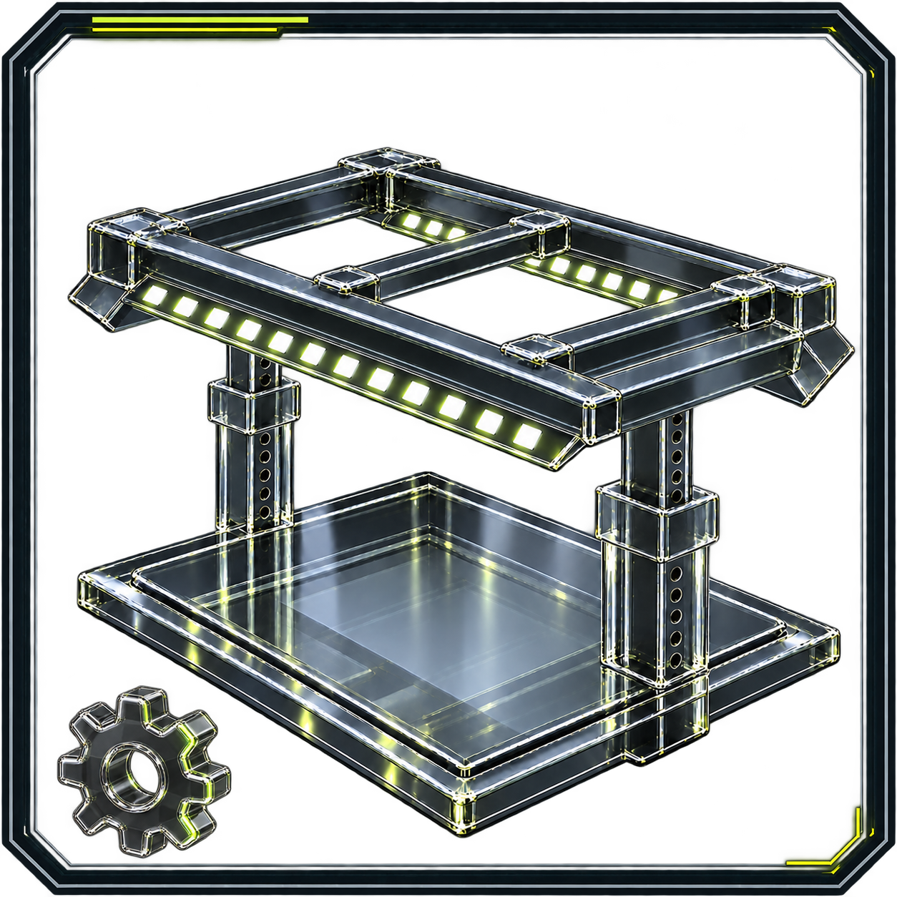

# Joseph Edwards

**Systems operations · CRM and API integrations · WordPress · Design evaluation**

I build the systems behind day-to-day work: business platforms, connected workflows, and web interfaces that help people complete a task. My portfolio also includes AI-assisted visual development, design critique, and original creative projects.

**Open to full-time and contract roles** in systems and IT operations, CRM and automation, web/product delivery, and AI design evaluation.

[LinkedIn](https://www.linkedin.com/in/josephedwardscto/) · [Experience and dates](docs/BACKGROUND.md) · [Browse repositories](https://github.com/RawPowered?tab=repositories)

[Selected work](#featured-projects) · [Find your role](#start-here) · [In development](#in-development) · [More projects](#additional-projects) · [How I work](#how-i-work)

<h2 id="featured-projects">Selected work</h2>

Six starting points, matching the pinned repositories below. Each links to the implementation, design work, or supporting records available for review.

| Project | My work | Current scope |
|---|---|---|
| **[Sunprise WordPress Case Study](https://github.com/RawPowered/Sunprise-WordPress-Case-Study)** | Business-system migration, WordPress website, content, and communications setup. | Historical case study with restored screenshots and dated staging evidence. |
| **[305UGC Showcase](https://github.com/RawPowered/305UGC-Showcase)** | Responsive construction website, guided intake, and WordPress-Zoho CRM architecture. | Website and integration showcase. Full customer-flow acceptance remains pending. |
| **[BlueRoof WP Theme](https://github.com/RawPowered/BlueRoof-WP-Theme-Showcase)** | Roofing website concept, service navigation, estimate journey, and responsive layouts. | Design preview with dated performance evidence. Theme source is private. |
| **[StrikeScope](https://github.com/RawPowered/StrikeScope)** | Multi-tenant CRM, entity and field permissions, MFA, and audit architecture. | Public source and implementation documentation. Sentinel remains on the roadmap. |
| **[Flow Fountain for CRMs](https://github.com/RawPowered/flow-fountain-for-crms)** | Self-hosted workflow authoring, integrations, execution review, and audit context. | Source preview built first for GoHighLevel/LeadConnector. Other CRMs need adapter work and configuration. |
| **[Earth To Jay](https://github.com/RawPowered/Earth-To-Jay-Portfolio)** | Original story and character development, screenplay work, and AI-art critique. | Creative development portfolio. Voice performance reel in production. |

<table>
<tr>
<td width="50%" valign="top">
<h3>Sunprise: migration and web delivery</h3>

Moved business files, email, and team services across Microsoft 365, Google Workspace, hosting, and web platforms. Built the WordPress site and configured Zoom Phone.

<a href="https://github.com/RawPowered/Sunprise-WordPress-Case-Study">Read the case study</a> · <a href="https://rawpowered.github.io/Sunprise-WordPress-Case-Study/">Visual walkthrough</a>

</td>
<td width="50%" valign="top">
<h3>BlueRoof: a clear service journey</h3>

A roofing theme concept organized around inspections, repairs, replacement, materials, and estimate requests. Desktop and mobile previews show the intended experience.

<a href="https://github.com/RawPowered/BlueRoof-WP-Theme-Showcase">Explore the design and evidence</a>

</td>
</tr>
</table>

**For design and AI evaluation roles:** start with [Earth To Jay's visual rejection study](https://github.com/RawPowered/Earth-To-Jay-Portfolio/blob/main/design-critique/README.md) and [LuxuryCatalog's design process](https://github.com/RawPowered/LuxuryCatalog/blob/main/docs/DESIGN-PROCESS.md). They show review criteria, rejected outputs, corrective direction, and refinement.

<h3 id="luxury-catalog">LuxuryCatalog: line art to catalog</h3>

Translated supplied door drawings into an AI-assisted imagery workflow with material guides, targeted corrections, finish variants, and catalog publishing. The repository preserves inputs, review criteria, source, and dated interface captures. [View the project](https://github.com/RawPowered/LuxuryCatalog) · [Browse the gallery](https://github.com/RawPowered/LuxuryCatalog/blob/main/docs/GALLERY.md).

<h2 id="start-here">Find your role</h2>

| Your focus | Start here |
|---|---|
| **Systems administration and IT support** | [Systems portfolio](https://github.com/RawPowered/Systems-Administration-Portfolio) · [Support operations](https://github.com/RawPowered/Support-Operations-Systems) · [Expert Solar experience](docs/EXPERT-SOLAR.md) |
| **CRM, APIs and automation** | [CRM portfolio](https://github.com/RawPowered/CRM-Integration-Portfolio) · [API and automation cases](https://github.com/RawPowered/API-Integration-Automation-Portfolio) |
| **WordPress, web and product interfaces** | [Web portfolio](https://github.com/RawPowered/Web-Experience-WordPress-Portfolio) · [BlueRoof](https://github.com/RawPowered/BlueRoof-WP-Theme-Showcase) |
| **AI design evaluation and visual quality** | [Design judgment](https://github.com/RawPowered/Design-Judgment-Portfolio) · [AI and design reading guide](docs/AI-AND-DESIGN.md) |
| **Game, narrative and physical product design** | [Game design](https://github.com/RawPowered/Game-Design-Portfolio) · [Earth To Jay](https://github.com/RawPowered/Earth-To-Jay-Portfolio) · [The Moun](https://github.com/RawPowered/TheMoun) |
| **Content, SEO and campaign management** | [Marketing portfolio](https://github.com/RawPowered/Marketing-SEO-Performance-Portfolio) · [Anonymized ad copy and campaign work](https://github.com/RawPowered/Facebook-Ads-Management-Showcase) |

<h2 id="in-development">In development</h2>

**[PowerPortals](https://github.com/RawPowered/PowerPortals-Showcase) and the [Zoho CRM suite](https://github.com/RawPowered/Zoho-CRM-Widgets): Tested & In Development / Pre-Release.** Work includes configurable project intake, customer and team workspaces, and companion CRM widgets. Testing covers documented development checks; production readiness and customer-specific acceptance remain pending. Public tours use fictional data.

**[SolHydrix](https://github.com/RawPowered/SolHydrix-Showcase): design preview.** A custom WordPress theme showcase with responsive design and build documentation.

<h2 id="additional-projects">More projects</h2>

Explore the wider portfolio

- **Web and plugins:** [Sunlectric theme](https://github.com/RawPowered/Sunlectric-Solar-WordPress-Showcase) · [Sales Partner Onboarding](https://github.com/RawPowered/Sales-Partner-Onboarding-Showcase).
- **Games:** [Crawl Brawl](https://github.com/RawPowered/Crawl-Brawl), a playable Windows beta with Godot source; [Civilian 66](https://github.com/RawPowered/Civilian66-Public), an Unreal Engine game in development with design material and early proof of play.
- **Physical products:** [The Moun](https://github.com/RawPowered/TheMoun), [Grade Station](https://github.com/RawPowered/Grade-Station), and [COMPIO](https://github.com/RawPowered/COMPIO). Design and engineering concepts; manufacturing readiness is unverified.
- **Business and research systems:** [RawOps Suite](https://github.com/RawPowered/RawOps-Suite), a historical business-platform archive; [OSINT Dive Deep](https://github.com/RawPowered/osint-dive-deep-v1), research source requiring operator configuration.
- **AI-assisted tools:** [RawGraded](https://github.com/RawPowered/RawGraded), [RawMarkets](https://github.com/RawPowered/RawMarkets), and [XRepHunter](https://github.com/RawPowered/XRepHunter). Each repository explains its implementation and review limits.
- **Workflow guidance:** [Grok Bot Templates](https://github.com/RawPowered/Grok-Bot-Templates) and [Enterprise AI workflow guides](https://github.com/RawPowered/GPT-5.6-SOL-Enterprise-Master-Suite). Independent projects with no vendor endorsement.
- **Utilities:** [DNS Sentinel](https://github.com/RawPowered/DNS-Sentinel) for domain/email diagnostics and [OrphanHunter](https://github.com/RawPowered/OrphanHunter) for code-reference analysis.

Visual portfolio routes

<table>
<tr>
<td width="50%"></td>
<td width="50%"></td>
</tr>
<tr>
<td width="50%"></td>
<td width="50%"></td>
</tr>
<tr>
<td width="50%"></td>
<td width="50%"></td>
</tr>
</table>

<h2 id="operational-experience">Operational experience</h2>

At **Expert Solar, October 2023 - October 2025**, I administered business systems, took over CRM delivery requests, and supported the Salesforce-to-Zoho transition. At **SunPrise, October 2025 - October 2026**, my work covered website delivery, business-platform migration, and communications. SunPrise's month-level dates are approximate; the formal engagement has ended.

Earlier work spans CRM administration, business operations, WordPress multisite, and learning platforms. [Experience and LinkedIn-aligned dates](docs/BACKGROUND.md) · [Expert Solar records and scope](docs/EXPERT-SOLAR.md) · [Operations background](docs/OPERATIONS.md).

<h2 id="how-i-work">How I work</h2>

I map the process and data boundaries, build the workflow or interface, and check failure paths and recovery. I use AI-assisted development tools while owning architecture, review, debugging, and release decisions. Project notes distinguish implemented behavior, dated checks, and remaining acceptance work.

[Design decisions](docs/DESIGN.md) · [Engineering walkthrough](docs/ENGINEERING.md) · [Access controls and verification scope](docs/SECURITY-AND-PRIVACY.md)

**Core tools:** WordPress/PHP · Zoho CRM · REST APIs and webhooks · TypeScript/JavaScript · React · Node.js · Python · SQL · Microsoft 365 · Google Workspace.

**Creative tools and methods:** Godot · Unreal Engine · screenplay and character development · AI-assisted visual review.

[Connect on LinkedIn](https://www.linkedin.com/in/josephedwardscto/) to discuss the project closest to your team's needs.
