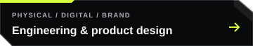
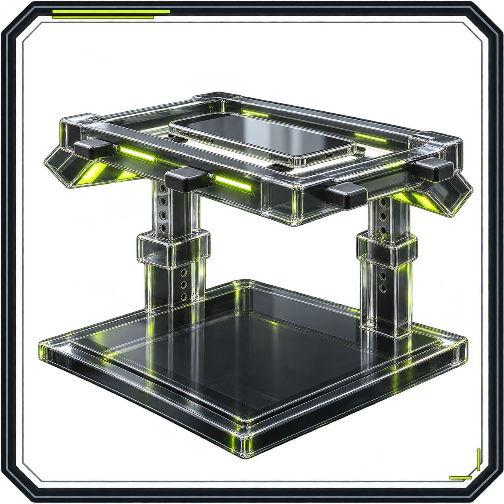
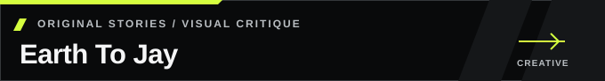
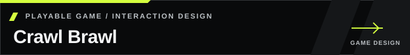
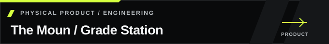

# Joseph Edwards

I build practical systems and products, and make the design decisions behind them reviewable. My work connects CRM and API delivery, workflow automation, web and product interfaces, applied AI, and creative development across games, characters, and stories.

**Open to AI design evaluation and quality review, systems and IT operations, automation, web/product delivery, and creative roles.** Start with the evidence closest to your opening; each case identifies my contribution, the available work, and its current stage.

 

**Start with the work:** [AI art critique](https://github.com/RawPowered/Earth-To-Jay-Portfolio/blob/main/design-critique/README.md) · [Line art to catalog](https://github.com/RawPowered/LuxuryCatalog/blob/main/docs/DESIGN-PROCESS.md) · [Released workflow source](https://github.com/RawPowered/flow-fountain-for-crms) · [Playable game beta](https://github.com/RawPowered/Crawl-Brawl/releases/latest)

**Explore:** [All six categories](#find-your-route) · [Role guide](#start-here) · [Selected work](#featured-projects) · [More projects](#additional-projects) · [Operational experience](#operational-experience) · [How I work](#how-i-work)

<h2 id="find-your-route"> Find your route</h2>

Choose a discipline to explore the portfolio. Each route connects the projects, contribution details, and supporting evidence for that area.

<table>
<tr>
<td width="50%" valign="top">
<h3 id="systems-it-automation">Systems, IT and automation</h3>

Systems administration, CRM, workflow automation, APIs, integrations, and support operations. Additional cases: <a href="https://github.com/RawPowered/RawOps-Suite">RawOps Suite</a> and <a href="https://github.com/RawPowered/StrikeScope">StrikeScope</a>.

  

</td>
<td width="50%" valign="top">
<h3 id="web-digital-products">Web and digital products</h3>

Responsive desktop and mobile experiences, WordPress, multisite, LMS, and product interfaces. See also <a href="https://github.com/RawPowered/PowerPortals-Showcase">PowerPortals</a> and the <a href="https://github.com/RawPowered/RoofRoofTexas-Rebuild">RoofRoofTexas rebuild</a>.

 

</td>
</tr>
<tr>
<td width="50%" valign="top">
<h3 id="creative-interactive">Creative and interactive design</h3>

Show and screenplay writing, illustration, UI/UX, game stories, player loops, systems, and economies. Game implementation examples use Godot and Unreal Engine.

  

</td>
<td width="50%" valign="top">
<h3 id="ai-emerging-technology">AI and emerging technology</h3>

Visual critique, AI-assisted products, model integration, research and content assessment, and image or video development. <a href="docs/AI-AND-DESIGN.md">Start with the AI and design reading guide</a>; model use and project stage are identified in each case.

     

</td>
</tr>
<tr>
<td width="50%" valign="top">
<h3 id="physical-products"><a href="docs/PROJECT-SHOWCASES.md#physical-product-work">Engineering and product design</a></h3>

Physical product concepts spanning product engineering, design, branding, and supporting digital experiences.

<a href="https://github.com/RawPowered/TheMoun">The Moun: complete design and engineering archive</a> — CAD references, electrical diagrams, manufacturing plans, research, and original artwork. Portfolio review only; original rights reserved.

 

</td>
<td width="50%" valign="top">
<h3 id="marketing-growth">Marketing and growth</h3>

Organic search, content, and social media work across organic and paid channels. <a href="https://github.com/RawPowered/Facebook-Ads-Management-Showcase">Inspect the paid campaign evidence</a>.

</td>
</tr>
</table>

<strong>Looking for another fit?</strong> Start with the project closest to the work, then follow its design, engineering, or operations evidence.

<h2 id="start-here"> Start with your role</h2>

| Your focus | Evidence to review first |
|---|---|
| **AI Tutor / AI Design Tutor / design QA** | [Ten visual rejection decisions](https://github.com/RawPowered/Earth-To-Jay-Portfolio/blob/main/design-critique/README.md) · [LuxuryCatalog review and refinement](https://github.com/RawPowered/LuxuryCatalog/blob/main/docs/DESIGN-PROCESS.md) · [Interface critique and rubric](https://github.com/RawPowered/Design-Judgment-Portfolio/blob/main/docs/WALKTHROUGH.md) |
| **Applied AI / evaluation workflows** | [RawGraded image assessment](https://github.com/RawPowered/RawGraded) · [XRepHunter review signals](https://github.com/RawPowered/XRepHunter) · [Prompt and evaluation guide](https://github.com/RawPowered/GPT-5.6-SOL-Enterprise-Master-Suite) |
| **Systems / IT / CRM / automation** | [Expert Solar systems ownership](docs/EXPERT-SOLAR.md) · [Flow Fountain source](https://github.com/RawPowered/flow-fountain-for-crms) · [API and automation cases](https://github.com/RawPowered/API-Integration-Automation-Portfolio) |
| **Web / product / UI and UX** | [305UGC web and mobile](https://github.com/RawPowered/305UGC-Showcase) · [PowerPortals guided intake](https://github.com/RawPowered/PowerPortals-Showcase#product-tour) · [RoofRoofTexas rebuild](https://github.com/RawPowered/RoofRoofTexas-Rebuild) |
| **Game / narrative / creative development** | [Crawl Brawl gameplay](https://github.com/RawPowered/Crawl-Brawl#latest-gameplay-full-frame) · [Civilian 66 design](https://github.com/RawPowered/Game-Design-Portfolio) · [Earth To Jay script](https://github.com/RawPowered/Earth-To-Jay-Portfolio/blob/main/script-sample/opening-excerpt.fountain) |
| **Product design / marketing / operations** | [The Moun design archive](https://github.com/RawPowered/TheMoun) · [Marketing and SEO evidence](https://github.com/RawPowered/Marketing-SEO-Performance-Portfolio) · [Construction and sales operations](docs/OPERATIONS.md#construction-and-sales-operations) |

<h2 id="featured-projects"> Selected work</h2>

Six ways to inspect my design judgment, implementation, and creative direction. Follow the evidence link in each case for its full scope.

<table>
<tr>
<td width="50%" valign="top">
<h3 id="luxury-catalog">LuxuryCatalog</h3>

<strong>My work:</strong> translated supplied door drawings into a repeatable AI-assisted imagery workflow, with material guides, targeted corrections, finish variants, and catalog publishing.

<strong>Evidence:</strong> preserved inputs, review criteria, dated interface captures, source, and selected redacted pages from a 78-page catalog. The examples document retained work; they are not a newly executed generation run.

<a href="https://github.com/RawPowered/LuxuryCatalog/blob/main/docs/DESIGN-PROCESS.md">Review the design process</a> · <a href="https://github.com/RawPowered/LuxuryCatalog/blob/main/docs/GALLERY.md">Full gallery</a>

</td>
<td width="50%" valign="top">
<h3 id="earth-to-jay">Earth To Jay</h3>

Original animated-adventure concept with show planning, character writing, and screenplay work. <strong>Voice performance reel in production.</strong>

<strong>Design evaluation:</strong> ten rejected AI-art examples explain character, silhouette, anatomy, style, and story-fidelity failures, with specific corrective direction. <a href="https://github.com/RawPowered/Earth-To-Jay-Portfolio/blob/main/design-critique/README.md">Read the rejection study</a>.

<strong>Visual development:</strong> AI-assisted storyboard concepts, identified as development images.

 

</td>
</tr>
<tr>
<td width="50%" valign="top">
<h3 id="flow-fountain">Flow Fountain for CRMs</h3>

Self-hosted workflow authoring, integration controls, execution review, and audit context.

<strong>Source preview:</strong> built first for GoHighLevel/LeadConnector. Each additional CRM needs its own adapter and configuration.

  

</td>
<td width="50%" valign="top">
<h3 id="powerportals">PowerPortals</h3>

Designed configurable project intake, customer and team workspaces, and Zoho companion widgets.

<strong>Evidence:</strong> fictional-data product tours and design decisions. Private validation; commercial installation is reviewed separately.

  

</td>
</tr>
<tr>
<td width="50%" valign="top">
<h3 id="crawl-brawl">Crawl Brawl</h3>

<strong>Evidence:</strong> playable Windows beta and Godot project. Digging, resource collection, base building, defense, and combat form the current play loop.

  

</td>
<td width="50%" valign="top">
<h3 id="the-moun">The Moun / Grade Station</h3>

<strong>My work:</strong> a capture-workstation product program spanning physical design, engineering, branding, research, and its digital presentation.

<strong>Evidence:</strong> 33 readable sections, CAD/editor references, electrical diagrams, manufacturing plans, and original artwork. Product development and planning material; manufacturing readiness and hardware qualification are not established.

<a href="https://github.com/RawPowered/TheMoun/blob/main/docs/INDEX.md">Explore the complete design archive</a>

</td>
</tr>
</table>

<h2 id="additional-projects"> More projects and evidence</h2>

<h3 id="systems-and-digital-products">Systems and digital products</h3>

<table>
<tr>
<td width="50%" valign="top">
<h3 id="305ugc-suite">305UGC Suite</h3>

Built a responsive construction website and guided project intake, with a documented WordPress–Zoho CRM architecture.

<strong>Evidence:</strong> desktop/mobile website captures and integration walkthrough. <a href="https://github.com/RawPowered/305UGC-Showcase/blob/main/docs/PROJECT-STATUS.md">Project scope</a>: full customer-flow acceptance remains pending.

  

</td>
<td width="50%" valign="top">
<h3 id="osint-dive-deep">OSINT Dive Deep</h3>

Research studio, web API, provider adapters, and job-scoped worker architecture.

<strong>Released source:</strong> hosted services and optional providers need operator configuration.

  

</td>
</tr>
</table>

<strong>More systems cases:</strong> <a href="https://github.com/RawPowered/RawOps-Suite">RawOps Suite</a> — historical business platform, redacted screens and source; <a href="https://github.com/RawPowered/StrikeScope">StrikeScope</a> — CRM access controls and platform architecture. <a href="https://github.com/RawPowered/RoofRoofTexas-Rebuild">RoofRoofTexas</a> adds a documented web rebuild and before/after design.

<h3 id="creative-and-interactive-work">Creative and interactive work</h3>

<table>
<tr>
<td width="50%" valign="top">
<h3 id="civilian66-game-design">Civilian 66: gameplay systems and technical design</h3>

</td>
<td width="50%" valign="top">

Story and world direction, character work, progression case studies, and a proposed Bloopi plush line.

<strong>Status:</strong> independent game in development. The public project page is a curated showcase; its Unreal Engine clip is an early proof of play, not a public standalone release.

  

</td>
</tr>
</table>

<h3 id="ai-and-model-work">AI and model work</h3>

     

<table>
<tr>
<td width="50%" valign="top"><h4>RawGraded Studio</h4>
Local-first card capture, image analysis, deterministic grading math, and optional AI evidence passes. <a href="https://github.com/RawPowered/RawGraded">Review architecture and source boundaries</a>.
</td>
<td width="50%" valign="top"><h4>XRepHunter</h4>
Browser-extension prototype for social content assessment, with local heuristics and optional browser-based models. Public source, tests, architecture, and redacted running-interface captures. Scores remain human-review signals. <a href="https://github.com/RawPowered/XRepHunter">Inspect the prototype</a>.
</td>
</tr>
<tr>
<td width="50%" valign="top"><h4>RawMarkets</h4>
Source and historical interface captures of a market-research desktop product with data ingestion, portfolio tools, and an optional AI copilot. <a href="https://github.com/RawPowered/RawMarkets">Review the product</a>.
</td>
<td width="50%" valign="top"><h4>Enterprise AI workflow guide</h4>
Independent prompt libraries, workflow guidance, and evaluation material. Published guidance is distinct from demonstrated runtime performance. <a href="https://github.com/RawPowered/GPT-5.6-SOL-Enterprise-Master-Suite">Explore the publication</a>.
</td>
</tr>
</table>

<a href="docs/AI-AND-DESIGN.md">AI and design reading guide</a> · <a href="https://github.com/RawPowered/Design-Judgment-Portfolio">Design critique and evaluation rubric</a>. LuxuryCatalog's generation, batch processing, PDF export, and PDF-based recovery are detailed in the selected case above. Model use and project status accompany each example.

<h3 id="physical-product-work">Physical product work</h3>

Product concepts that bring industrial design, engineering details, brand systems, and companion experiences together.

 

<h3 id="historical-web-and-education-work">Earlier web and education work</h3>

Earlier work includes WordPress multisite and LMS development through TactiveLearning and cannabisuniversity.org. A surviving public archive shows a 2013 Gravity Forms question posted under the TactiveLearning name, supporting a historical WordPress and form-work connection. I recall that TactiveLearning served Western Governors University cohorts and reached more than 10,000 learners over its lifetime; the surviving public record does not independently verify the university relationship or learner count.

<h2 id="operational-experience"> Operational experience</h2>

At Expert Solar, I administered business systems, took over outstanding CRM delivery requests, and supported the Salesforce-to-Zoho transition. My reported outcome was a reduction of approximately **$20K/month** in external development expense after delivery moved in-house.

The legacy Zoho account preserves partial history of a previously functional system. Its full historical automation setup is unavailable for review. The savings figure is my reported business outcome, separate from the retained CRM records. [Review the evidence and limits](docs/EXPERT-SOLAR.md) · [SaaS administration, migration, and Apple MDM](docs/BACKGROUND.md)

<h2 id="security-privacy"> Security, privacy, and engineering judgment</h2>

I separate sign-in from record access, keep integration credentials server-side, and define which fields an endpoint may return. [Review the diagrams and verification scope](docs/SECURITY-AND-PRIVACY.md).

<h2 id="how-i-work"> How I work</h2>

I map the process, decision authority, and data boundaries first. I design for failure and recovery, then document the implementation and the evidence it supports. I use Cursor and Codex to speed development; I define architecture, review code, debug failures, and set release scope. [Design review](docs/DESIGN.md) · [Engineering walkthrough](docs/ENGINEERING.md).

**Tools and methods:** Zoho CRM · Salesforce-to-Zoho migration · REST APIs · workflow automation · WordPress · responsive and mobile UX · technical SEO · TypeScript/JavaScript · Python · PHP · SQL · Node.js · React · Godot · Unreal Engine · Microsoft 365 · Google Workspace · GitHub Actions · AI model integration and evaluation.

<h2 id="more-tools"> More tools</h2>

<table>
<tr>
<td width="50%" valign="top"></td>
<td width="50%" valign="top"></td>
</tr>
<tr>
<td width="50%" valign="top"></td>
<td width="50%" valign="top"></td>
</tr>
</table>

<a href="https://github.com/RawPowered?tab=repositories">Browse all public repositories</a>

<h2 id="before-we-meet"> Before we meet</h2>

- **Where might I contribute?** AI design evaluation and quality review, systems and IT operations, business platforms, web and product delivery, marketing, game design, and creative development. My experience spans construction, solar, enterprise systems, and independent products. I am especially interested in space, defense, and AI teams.
- **What can you review?** Public source, playable work, demonstrations, design material, selected historical records, and project status notes.
- **How should we start?** Follow the route closest to the opening. I can walk through the problem, my part in the work, the decisions, and the evidence that remains available.

More about my career interests

My experience spans construction and solar operations alongside independent products. I am open to business systems, IT and operations, automation, and web and product delivery, as well as AI design evaluation and quality review. My creative interests include screenwriting and story development, voice acting and performance, and game design and development. The portfolio includes script and story material, UI/UX, game systems, and playable prototypes, with my contribution and each project's stage identified.

I am especially interested in space, defense, AI, industrial technology, construction, and solar.

[Connect on LinkedIn](https://www.linkedin.com/in/josephedwardscto/)
