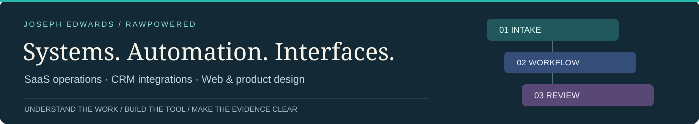
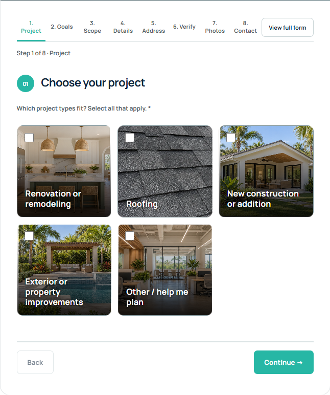
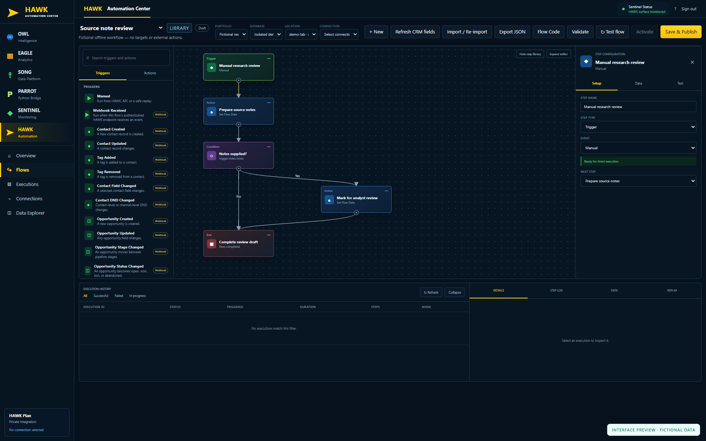
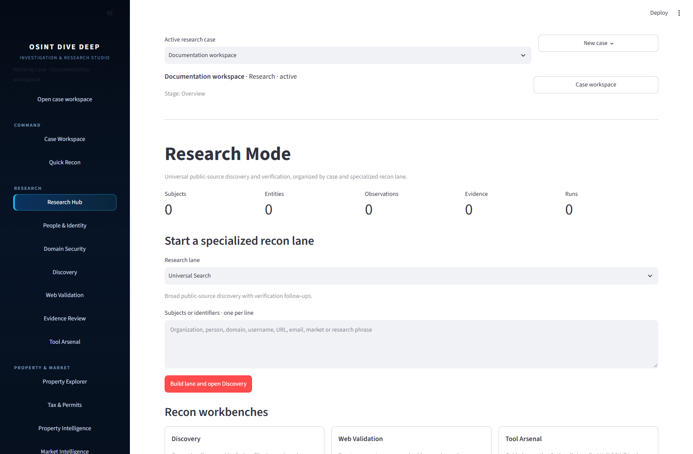

# Joseph Edwards

**Product & systems engineer · CRM integrations · Workflow automation**

I build software that connects customer-facing experiences to the systems a business runs on. My work spans responsive web interfaces, CRM APIs, role-scoped portals, automation workspaces, and research tools—with the configuration, access controls, and release checks that support them.

**Open to full-time and contract opportunities** in product engineering, solutions and integration engineering, and CRM/business systems.

[LinkedIn](https://www.linkedin.com/in/josephedwardscto/) · [Engineering walkthrough](docs/ENGINEERING.md) · [Explore my repositories](https://github.com/RawPowered?tab=repositories)

## Start with the work

<table>
<tr>
<td width="50%" valign="top">
<h3><a href="https://github.com/RawPowered/305UGC-Showcase">305UGC Suite</a></h3>

<strong>Website, customer intake and CRM operations.</strong> A company-specific build connecting responsive web design, guided project requests, WordPress and Zoho CRM.

Explore server-side CRM transport, durable request receipts, retry handling, customer membership boundaries, and the measured search/content record.

Live public website and intake rendering. Full CRM/customer-journey acceptance remains documented separately.

<a href="https://github.com/RawPowered/305UGC-Showcase/blob/main/docs/CRM-AND-AUTOMATION.md">CRM &amp; automation</a> · <a href="https://github.com/RawPowered/305UGC-Showcase/blob/main/docs/SECURITY-PRACTICES.md">Access &amp; security</a>

</td>
<td width="50%" valign="top">
<h3><a href="https://github.com/RawPowered/PowerPortals-Showcase">PowerPortals</a></h3>

<strong>A configurable portal product.</strong> Guided intake, customer follow-up, team workspaces and Zoho companion widgets designed around each business's CRM schema.

Explore service-specific question paths, property context, module/field discovery, configurable mappings, and separate account and project approval.

Private development and validation. Public tour uses fictional data; the customer-hub concept is labeled.

<a href="https://github.com/RawPowered/PowerPortals-Showcase#product-tour">Product tour</a> · <a href="https://github.com/RawPowered/PowerPortals-Showcase#capabilities-in-private-validation">Capabilities &amp; status</a>

</td>
</tr>
<tr>
<td width="50%" valign="top">
<h3><a href="https://github.com/RawPowered/flow-fountain-for-crms">Flow Fountain for CRMs</a></h3>

<strong>Self-hosted workflow and integration tooling.</strong> A visual automation workspace with operational review, scoped connections, audit context and preservation jobs.

Explore triggers, conditions and actions; HTTP/SQL integration controls; reviewed Python handlers; and Windows/Linux release checks. Originally built for GoHighLevel/LeadConnector.

Source preview. Other CRM adapters require implementation/configuration; live MySQL and external integration acceptance remain unverified.

<a href="https://github.com/RawPowered/flow-fountain-for-crms/blob/main/content/docs/architecture.md">Architecture</a> · <a href="https://github.com/RawPowered/flow-fountain-for-crms/actions/workflows/ci.yml">Automated checks</a>

</td>
<td width="50%" valign="top">
<h3><a href="https://github.com/RawPowered/osint-dive-deep-v1">OSINT Dive Deep</a></h3>

<strong>Research tools with evidence context.</strong> A local research studio, web API, frontend and job-scoped cloud worker for organizing public-source investigations.

Explore cases, observations, provenance, property/domain research, and optional tool adapters. The public release begins with a blank workspace.

Released source. Hosted services and optional tools require operator configuration, dependencies and authorization.

<a href="https://github.com/RawPowered/osint-dive-deep-v1/blob/main/docs/ARCHITECTURE.md">Complete stack</a> · <a href="https://github.com/RawPowered/osint-dive-deep-v1/actions/workflows/verify.yml">Release verification</a>

</td>
</tr>
</table>

305UGC is the company-specific implementation; PowerPortals is the reusable product. Their relationship and verification boundaries are explained in the linked showcases.

## A route for your team

| Your engineering need | Start here | What to inspect |
|---|---|---|
| Product or platform engineering | PowerPortals + Dive Deep | Interface design, modular architecture, APIs, configuration and release boundaries |
| Solutions, integration or deployment engineering | 305UGC + Flow Fountain | Workflow discovery, schema mapping, remote-service failure handling and operational handoffs |
| CRM and business systems | 305UGC + PowerPortals | Zoho, WordPress, Deluge/API workflows, customer portals and role-scoped records |
| Developer tools and AI-enabled workflows | Dive Deep + the tools below | Research interfaces, evidence handling, local-first applications and reviewable automation |

## How I approach the work

- **Understand the operation.** Map the people, records, decisions and handoffs before choosing the interface or integration.
- **Keep authority explicit.** Separate authentication, roles, record scope and customer/project membership. Keep credentials on the server.
- **Design for interruptions.** Use durable receipts, stable identifiers, retry-aware delivery and reviewable operational state where the workflow needs them.
- **Make verification visible.** Document what is implemented, what has been observed, what is illustrated, and what still needs acceptance testing.

I use AI-assisted development tools as part of my workflow. Architecture decisions, source review, debugging, verification and release scope remain work I own. My portfolio focuses on applications and integration engineering.

## Additional selected work

| Project | Engineering focus |
|---|---|
| [RawGraded](https://github.com/RawPowered/RawGraded) + [RawEngine](https://github.com/RawPowered/RawEngine) | Local-first AI application workflows, desktop/mobile capture and deterministic analysis traces |
| [OrphanHunter](https://github.com/RawPowered/OrphanHunter) | Developer tooling for mapping PHP/SQL/JavaScript references and investigating migration problems |
| [DNS Sentinel](https://github.com/RawPowered/DNS-Sentinel) | Domain/email migration diagnostics, audit history and server-proxied assistance |
| [RawInvestor](https://github.com/RawPowered/RawInvestor) | Desktop application delivery, a loopback API, local data and a Microsoft Store distribution story |

## Working stack

**TypeScript / JavaScript · Python · PHP · SQL**  
React, Node.js/Express, Streamlit, WordPress, MySQL, SQLite, REST APIs, webhooks, Zoho CRM/Flow/Deluge, Salesforce, Git and GitHub Actions.

My earlier business-systems work includes CRM administration and migrations, operational automation, user lifecycle and permissions, and Microsoft 365/Google Workspace transitions. The selected projects above show how I carry that operational experience into product engineering.

## Let's discuss the system you need to build

I'm interested in teams building developer products, AI-enabled applications, internal platforms, and connected customer operations. I also work directly with businesses that need CRM integrations, portals, migrations or workflow automation.

[Connect with me on LinkedIn](https://www.linkedin.com/in/josephedwardscto/).

Public repositories distinguish implementation, preview/demo material and verification status. Client source, credentials and customer records remain private. Product and company names are used descriptively.
