
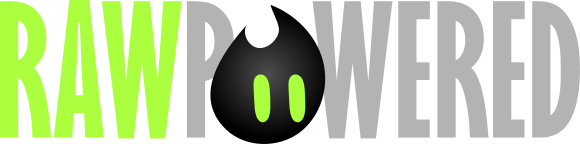

# Joseph Edwards

**Systems architecture · Web design · Applied AI** 
Remote · Full-time & contract

<a href="docs/SYSTEMS-WEB.md#gh-light-mode-only"><picture><source media="(max-width: 900px)" srcset="assets/profile/v4/systems-light-mobile.svg">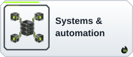</picture></a>
<a href="docs/WEB-DESIGN.md#gh-light-mode-only"><picture><source media="(max-width: 900px)" srcset="assets/profile/v4/web-light-mobile.svg"></picture></a>
<a href="docs/AI-EVALUATION.md#gh-light-mode-only"><picture><source media="(max-width: 900px)" srcset="assets/profile/v4/ai-light-mobile.svg">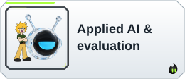</picture></a>
<a href="docs/CREATIVE-PRODUCT.md#gh-light-mode-only"><picture><source media="(max-width: 900px)" srcset="assets/profile/v4/creative-light-mobile.svg">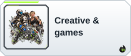</picture></a>
<a href="https://github.com/RawPowered/TheMoun#gh-light-mode-only"><picture><source media="(max-width: 900px)" srcset="assets/profile/v4/engineering-light-mobile.svg">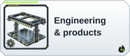</picture></a>
<a href="https://github.com/RawPowered/Marketing-SEO-Performance-Portfolio#gh-light-mode-only"><picture><source media="(max-width: 900px)" srcset="assets/profile/v4/marketing-light-mobile.svg"></picture></a>

<a href="docs/SYSTEMS-WEB.md#gh-dark-mode-only"><picture><source media="(max-width: 900px)" srcset="assets/profile/v4/systems-dark-mobile.svg">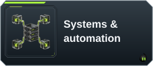</picture></a>
<a href="docs/WEB-DESIGN.md#gh-dark-mode-only"><picture><source media="(max-width: 900px)" srcset="assets/profile/v4/web-dark-mobile.svg"></picture></a>
<a href="docs/AI-EVALUATION.md#gh-dark-mode-only"><picture><source media="(max-width: 900px)" srcset="assets/profile/v4/ai-dark-mobile.svg">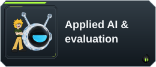</picture></a>
<a href="docs/CREATIVE-PRODUCT.md#gh-dark-mode-only"><picture><source media="(max-width: 900px)" srcset="assets/profile/v4/creative-dark-mobile.svg">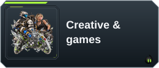</picture></a>
<a href="https://github.com/RawPowered/TheMoun#gh-dark-mode-only"><picture><source media="(max-width: 900px)" srcset="assets/profile/v4/engineering-dark-mobile.svg">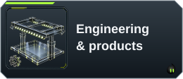</picture></a>
<a href="https://github.com/RawPowered/Marketing-SEO-Performance-Portfolio#gh-dark-mode-only"><picture><source media="(max-width: 900px)" srcset="assets/profile/v4/marketing-dark-mobile.svg">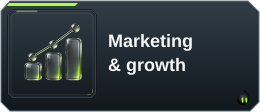</picture></a>

**[Noteworthy repos](#noteworthy-repos)** · [Web delivery](https://github.com/RawPowered/Sunprise-WordPress-Case-Study) · [AI critique](https://github.com/RawPowered/power-portals-ai-video-presentation-showcase) · [Systems](docs/EXPERT-SOLAR.md)

  <a href="docs/WEB-DESIGN.md">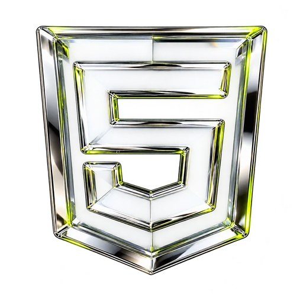</a> <a href="docs/WEB-DESIGN.md">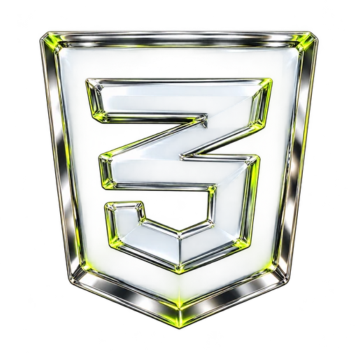</a> <a href="docs/WEB-DESIGN.md">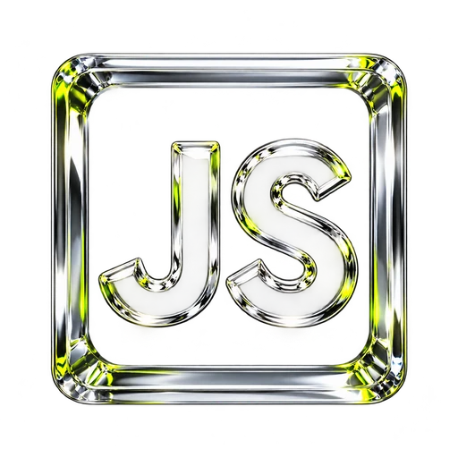</a> <a href="docs/WEB-DESIGN.md">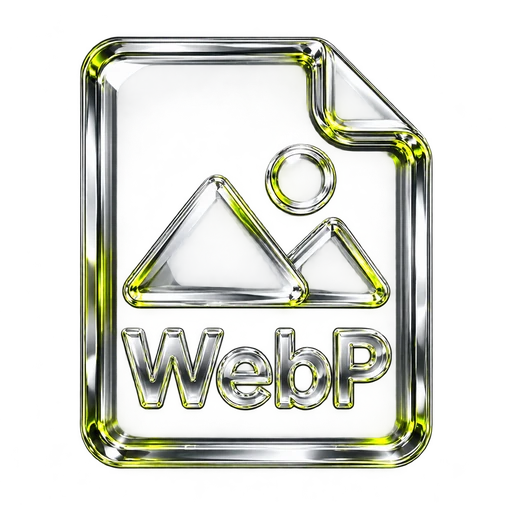</a>

<!-- noteworthy-repos:start -->
## Noteworthy repos

[Roles](#roles) · [Research](#research) · [Industries](#industries)

### Roles

#### AI Design Tutor

<table>
<tr><td colspan="2"><a href="https://github.com/RawPowered/power-portals-ai-video-presentation-showcase"><picture><source media="(max-width: 900px)" srcset="assets/profile/noteworthy/powerportals-mobile.svg">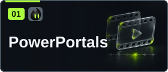</picture></a> Finished film, 17 critiques and documented creative decisions.   </td></tr>
<tr><td width="24" align="center">02</td><td><a href="https://github.com/RawPowered/LuxuryCatalog">LuxuryCatalog</a></td></tr>
<tr><td colspan="2">Reviewed catalog imagery, persistent queues and PDF publishing.   </td></tr>
<tr><td width="24" align="center">03</td><td><a href="https://github.com/RawPowered/Earth-To-Jay-Portfolio">Earth To Jay</a></td></tr>
<tr><td colspan="2">Original scripts, characters and ten AI art critiques.   </td></tr>
</table>

#### CRM Administrator

<table>
<tr><td colspan="2"><a href="https://github.com/RawPowered/RawOps-Suite"><picture><source media="(max-width: 900px)" srcset="assets/profile/noteworthy/rawops-mobile.svg">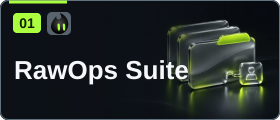</picture></a> Historical CRM source with redacted interface captures.   </td></tr>
<tr><td width="24" align="center">02</td><td><a href="https://github.com/RawPowered/CRM-Integration-Portfolio">CRM Portfolio</a></td></tr>
<tr><td colspan="2">Zoho and Salesforce administration, migration and workflow cases.   </td></tr>
<tr><td width="24" align="center">03</td><td><a href="https://github.com/RawPowered/StrikeScope">StrikeScope</a></td></tr>
<tr><td colspan="2">CRM source with role permissions and field-level access.   </td></tr>
</table>

#### Systems / IT / CRM Automation

<table>
<tr><td colspan="2"><a href="https://github.com/RawPowered/flow-fountain-for-crms"><picture><source media="(max-width: 900px)" srcset="assets/profile/noteworthy/flow-mobile.svg">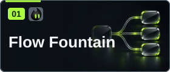</picture></a> Windows and Linux workflow preview with CRM integrations.   </td></tr>
<tr><td width="24" align="center">02</td><td><a href="https://github.com/RawPowered/StrikeScope">StrikeScope</a></td></tr>
<tr><td colspan="2">CRM source with role permissions and field-level access.   </td></tr>
<tr><td width="24" align="center">03</td><td><a href="https://github.com/RawPowered/DNS-Sentinel">DNS Sentinel</a></td></tr>
<tr><td colspan="2">Domain and email diagnostics for migration troubleshooting.   </td></tr>
</table>

#### Web / UIX

<table>
<tr><td colspan="2"><a href="https://github.com/RawPowered/Sunlectric-Solar-WordPress-Showcase"><picture><source media="(max-width: 900px)" srcset="assets/profile/noteworthy/sunlectric-mobile.svg">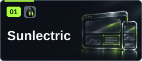</picture></a> Responsive solar theme with a visual Hero Studio.   </td></tr>
<tr><td width="24" align="center">02</td><td><a href="https://github.com/RawPowered/BlueRoof-WP-Theme-Showcase">BlueRoof</a></td></tr>
<tr><td colspan="2">Responsive roofing theme with previews and dated lab checks.   </td></tr>
<tr><td width="24" align="center">03</td><td><a href="https://github.com/RawPowered/Sunprise-WordPress-Case-Study">Sunprise</a></td></tr>
<tr><td colspan="2">Historical WordPress, file, email and communications migration.   </td></tr>
</table>

### Research

<table>
<tr><td colspan="2"><a href="https://github.com/RawPowered/server-to-ai-usage-research"><picture><source media="(max-width: 900px)" srcset="assets/profile/noteworthy/research-mobile.svg">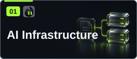</picture></a> Source-linked datasets, explicit denominators and local validation.   </td></tr>
<tr><td width="24" align="center">02</td><td><a href="https://github.com/RawPowered/ai-token-memory-drift-hallucination-research-2026-public">AI Memory & Drift</a></td></tr>
<tr><td colspan="2">Cited memory research with illustrative models and proposed evaluations.  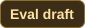 </td></tr>
<tr><td width="24" align="center">03</td><td><a href="https://github.com/RawPowered/Binance-Breach-Research">Breach Research</a></td></tr>
<tr><td colspan="2">Source register, claim review and incident attribution research.   </td></tr>
</table>

### Industries

#### Solar & Construction

<table>
<tr><td colspan="2"><a href="https://github.com/RawPowered/Sunlectric-Solar-WordPress-Showcase"><picture><source media="(max-width: 900px)" srcset="assets/profile/noteworthy/sunlectric-mobile.svg"></picture></a> Responsive solar theme with a visual Hero Studio.   </td></tr>
<tr><td width="24" align="center">02</td><td><a href="https://github.com/RawPowered/Sunprise-WordPress-Case-Study">Sunprise</a></td></tr>
<tr><td colspan="2">Historical WordPress, file, email and communications migration.   </td></tr>
<tr><td width="24" align="center">03</td><td><a href="https://github.com/RawPowered/BlueRoof-WP-Theme-Showcase">BlueRoof</a></td></tr>
<tr><td colspan="2">Responsive roofing theme with previews and dated lab checks.   </td></tr>
</table>

#### Commerce & Catalogs

<table>
<tr><td colspan="2"><a href="https://github.com/RawPowered/RawOps-Suite"><picture><source media="(max-width: 900px)" srcset="assets/profile/noteworthy/rawops-mobile.svg"></picture></a> Historical CRM source with redacted interface captures.   </td></tr>
<tr><td width="24" align="center">02</td><td><a href="https://github.com/RawPowered/LuxuryCatalog">LuxuryCatalog</a></td></tr>
<tr><td colspan="2">Reviewed catalog imagery, persistent queues and PDF publishing.   </td></tr>
<tr><td width="24" align="center">03</td><td><a href="https://github.com/RawPowered/RawGraded">RawGraded</a></td></tr>
<tr><td colspan="2">Local-first grading app with scoped public assurance source.   </td></tr>
</table>

#### Creative Media & Games

<table>
<tr><td colspan="2"><a href="https://github.com/RawPowered/power-portals-ai-video-presentation-showcase"><picture><source media="(max-width: 900px)" srcset="assets/profile/noteworthy/powerportals-mobile.svg"></picture></a> Finished film, 17 critiques and documented creative decisions.   </td></tr>
<tr><td width="24" align="center">02</td><td><a href="https://github.com/RawPowered/Crawl-Brawl">Crawl Brawl</a></td></tr>
<tr><td colspan="2">Playable Windows beta with Godot source and defense systems.   </td></tr>
<tr><td width="24" align="center">03</td><td><a href="https://github.com/RawPowered/Earth-To-Jay-Portfolio">Earth To Jay</a></td></tr>
<tr><td colspan="2">Original scripts, characters and ten AI art critiques.   </td></tr>
</table>
<!-- noteworthy-repos:end -->

[All 61 projects](docs/PORTFOLIO-INDEX.md) · [Research](#research) · [Experience](docs/BACKGROUND.md)
