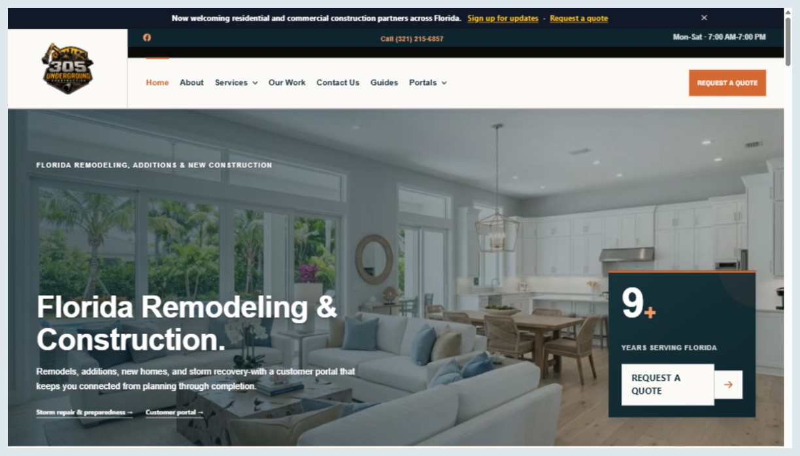
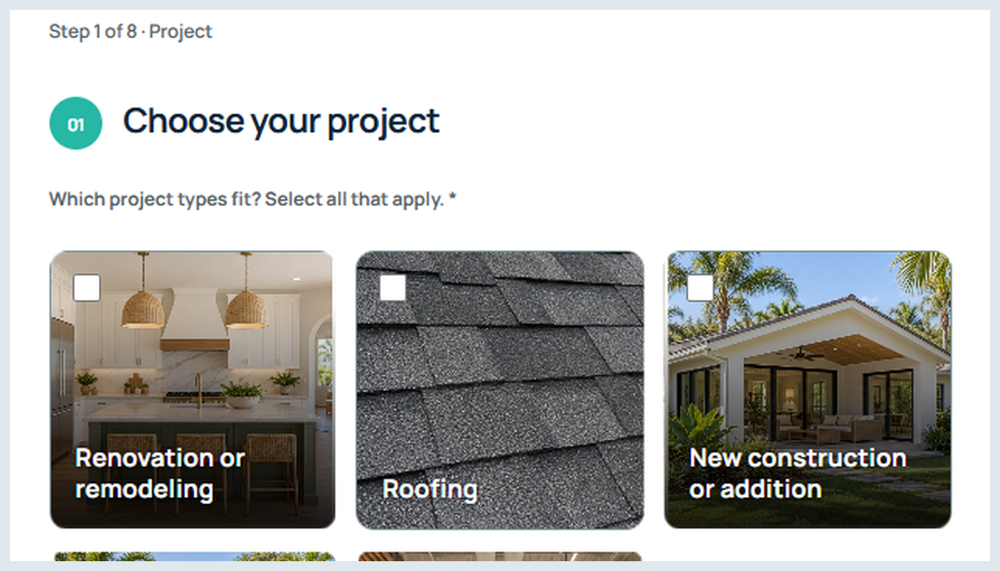
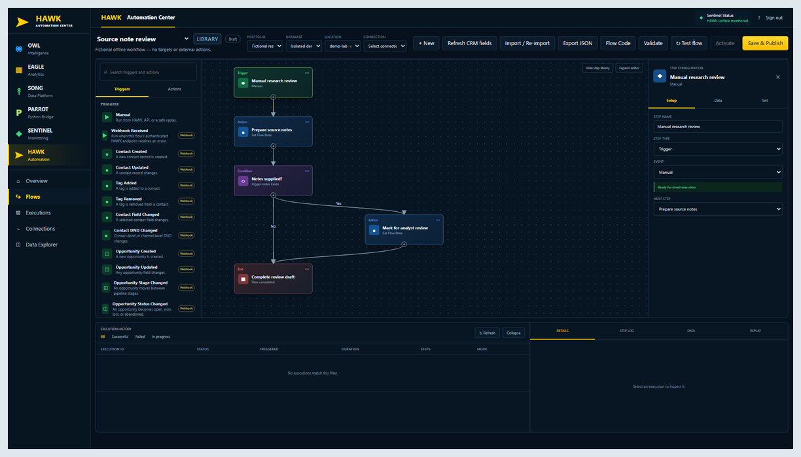

# Design & interfaces

[Profile](../README.md) · [Engineering](ENGINEERING.md) · [Security & privacy](SECURITY-AND-PRIVACY.md)

My interface work connects a clear first impression to a useful next step: understand the service, describe the work, provide context, and continue with appropriate feedback. The reviews examine visible work and identify the next usability checks.

## PowerPortals film: guide attention through motion

[Watch the finished 1:54 presentation](https://github.com/RawPowered/power-portals-ai-video-presentation-showcase/blob/main/media/versions/31.mp4) · [Explore 17 annotated critiques](https://github.com/RawPowered/power-portals-ai-video-presentation-showcase/blob/main/docs/critique-index.md)

**The task:** explain a connected contractor-workflow platform to a buyer using a few words and a clear visual action at a time.

**My direction:** replace boxed layouts with free-standing typography, show a trigger before its downstream actions, make task ownership visible, and carry one orange focal object through scene transitions. Later revisions tightened text alignment, reading holds, motion paths, buyer payoffs and sound timing.

**The judgement:** a transition can be technically continuous and still demand too much visual tracking. The direct circle-to-slash revision removed an intermediate tiny-dot detour. The [critique record](https://github.com/RawPowered/power-portals-ai-video-presentation-showcase/blob/main/docs/critiques/10.md) preserves the instruction, actual frames and the reason the earlier treatment was superseded.

**The evidence:** a finished film, early animatic, 17 annotated comparisons, authentic source frames, motion excerpts and outtake reasons. The analysis is retrospective. Illustrated task owners and replies communicate behavior; the presentation does not establish live execution of every product workflow or measured sales outcomes.

## 305UGC: connect the front door to the request

**The task:** help a visitor understand the construction offering and begin a useful project request.

**What works:** service-focused hierarchy and consistent request entry points connect the marketing surface with a structured workflow. The [desktop/mobile case](https://github.com/RawPowered/305UGC-Showcase#desktop-to-mobile) documents the responsive design at desktop and mobile sizes, with evidence for each view.

**The tradeoff:** project imagery establishes context, but large image areas can compete with the immediate next action. Mobile review should prioritize readable service labels, a clear request action, and the amount of information needed before commitment.

**What I would verify:** keyboard navigation, error recovery, touch-target spacing, and the full request path at narrow widths. The public showcase documents the captured website. Integration acceptance, usability study results, and accessibility conformance require separate validation.

## PowerPortals: make a complex request approachable

**The task:** gather the right project context without asking every visitor every possible question.

**What works:** labeled project cards make the first decision recognizable. A staged intake separates project selection from goals, scope, details, address, verification, photos, and contact. The full [product tour](https://github.com/RawPowered/PowerPortals-Showcase#product-tour) shows the uncropped interface and its private-validation status.

**The tradeoff:** image cards need persistent readable labels and explicit selected states; photographs alone cannot communicate selection or replace control labels. A progress indicator should explain position without becoming the most visually demanding part of the form.

**What I would verify:** multi-selection behavior, focus visibility, contrast on each image, back/continue state preservation, and field errors. The tour screens use fictional data and illustrate design decisions. Production acceptance remains unverified.

## Flow Fountain: distinguish authoring from operating

**The task:** compose a workflow and understand what will happen when it runs.

**What works:** the visual workspace makes relationships inspectable, while connections, execution review, and preservation belong to the wider operating model. The interface should help an operator distinguish a saved definition from a run and a run from a successful external outcome.

**The tradeoff:** a broad operations workspace can become dense. A focused view of one trigger, condition, action, and resulting state is more useful for review than an unreadable all-features screenshot.

**What I would verify:** empty/loading/failure states, selected-step clarity, safe edits, and whether execution feedback identifies the failed dependency. The preview labels mocked responses and identifies the states that need review against a live system.

## Applying the same critique to this profile

The profile places its six illustrated category routes directly after the introduction and compact jump navigation. The role-based reading guide and selected cases follow the categories, covering AI critique, catalog imagery, workflow software, interface design, games, and physical products. The category routes retain the existing illustrations and connect the rest of the portfolio. Individual AI summaries replace a dense multi-project paragraph, and repeated button captions are consolidated.

The existing header, category artwork, palette, and vector style are preserved. New project titles extend the same vector system. Text headings, descriptive image alt text, and direct evidence links accompany the artwork. The AI category opens a [curated reading guide](AI-AND-DESIGN.md) covering both design judgment and applied systems, rather than a single product.

Project status and verification limits remain attached to their cases. These changes are intended to improve navigation; recruiter conversion and usability effects remain unmeasured.

I use AI-assisted tools during implementation and editing. Clear critique, hierarchy, accurate status, source review, and responsibility for the final presentation remain essential parts of the work.
