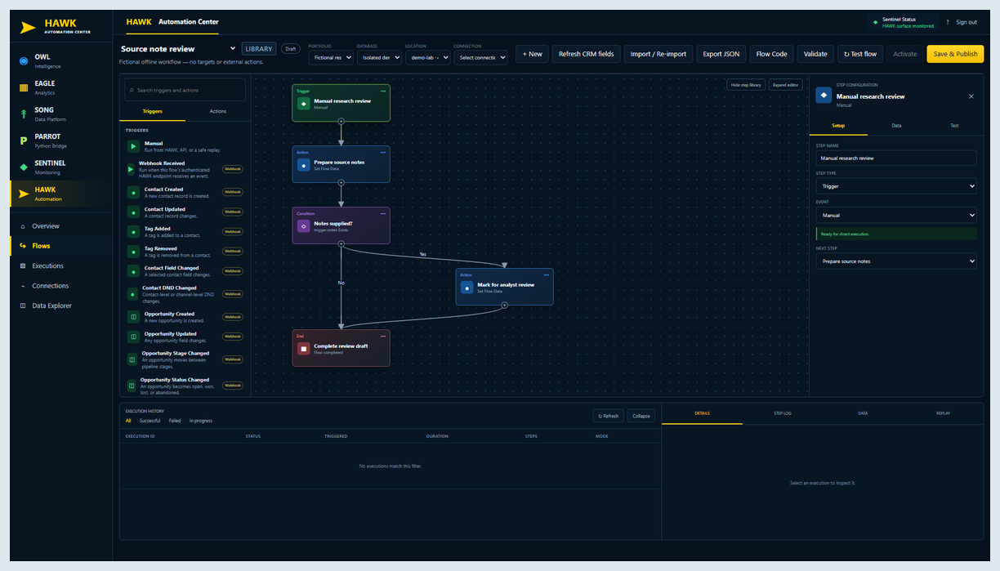

# Design & interfaces

[Profile](../README.md) · [Engineering](ENGINEERING.md) · [Security & privacy](SECURITY-AND-PRIVACY.md)

My interface work connects a clear first impression to a useful next step: understand the service, describe the work, provide context, and continue with appropriate feedback. These are design reviews of the visible work, not fabricated user-study results.

## 305UGC — connect the front door to the request

**The task:** help a visitor understand the construction offering and begin a useful project request.

**What works:** service-focused hierarchy and consistent request entry points connect the marketing surface with a structured workflow. The [desktop/mobile case](https://github.com/RawPowered/305UGC-Showcase#desktop-to-mobile) gives the responsive presentation its own evidence rather than treating a smaller screenshot as proof of mobile usability.

**The tradeoff:** project imagery establishes context, but large image areas can compete with the immediate next action. Mobile review should prioritize readable service labels, a clear request action, and the amount of information needed before commitment.

**What I would verify:** keyboard navigation, error recovery, touch-target spacing, and the full request path at narrow widths. The public showcase distinguishes the captured website from integration acceptance. It does not claim a completed usability study or blanket accessibility conformance.

## PowerPortals — make a complex request approachable

**The task:** gather the right project context without asking every visitor every possible question.

**What works:** labeled project cards make the first decision recognizable. A staged intake separates project selection from goals, scope, details, address, verification, photos, and contact. The full [product tour](https://github.com/RawPowered/PowerPortals-Showcase#product-tour) shows the uncropped interface and its private-validation status.

**The tradeoff:** image cards need persistent readable labels and explicit selected states; photographs alone cannot communicate selection or replace control labels. A progress indicator should explain position without becoming the most visually demanding part of the form.

**What I would verify:** multi-selection behavior, focus visibility, contrast on each image, back/continue state preservation, and field errors. Fictional-data tour screens support an interface discussion; they do not establish production acceptance.

## Flow Fountain — distinguish authoring from operating

**The task:** compose a workflow and understand what will happen when it runs.

**What works:** the visual workspace makes relationships inspectable, while connections, execution review, and preservation belong to the wider operating model. The interface should help an operator distinguish a saved definition from a run and a run from a successful external outcome.

**The tradeoff:** a broad operations workspace can become dense. A focused view of one trigger, condition, action, and resulting state is more useful for review than an unreadable all-features screenshot.

**What I would verify:** empty/loading/failure states, selected-step clarity, safe edits, and whether execution feedback identifies the failed dependency. Preview responses remain labeled; the design review does not convert them into live results.

## Applying the same critique to this profile

The earlier profile used a tall generic banner, repeated tags, uneven screenshot proportions, and several competing role routes. This revision reduces the banner, introduces two clear starting points, standardizes preview framing, and moves detailed proof into linked cases.

The change improves visual consistency and reduces duplication. It is an editorial/design revision, not a measured conversion or usability result. Preview crops retain real source pixels; full interface captures remain available through the original tours.

I use AI-assisted tools during implementation and editing. Clear critique, hierarchy, accurate status, source review, and responsibility for the final presentation remain essential parts of the work.
