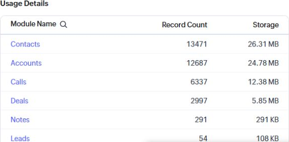
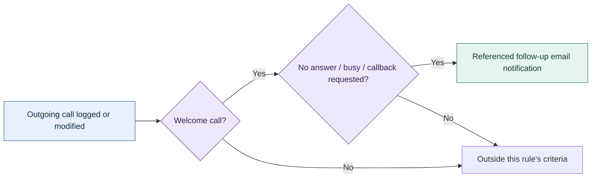

# Expert Solar: systems ownership and preserved history

[Profile](../README.md) · [Systems & operations](OPERATIONS.md) · [Background](BACKGROUND.md)

**Preserved partial history of a previously functional system.** The legacy Zoho account is an aged, incomplete record of the original operation. The former Zoho One environment and its wider automation setup are no longer fully available to demonstrate. The observations below were collected on October 24, 2026, without changing records or executing workflows.

## The work I owned

My responsibilities included CRM and SaaS administration, user lifecycle and permissions, data migration, operational workflows, internal tooling, and staff support. I took over outstanding development requests that had been handled through an external development contract. After delivery moved in-house, the company discontinued that contract, reducing recurring external development expense by approximately **$20,000 per month** from that point forward.

I also supported the transition from Salesforce to Zoho to reduce platform expense. The recurring development reduction is my reported historical business outcome, not a number derived from the CRM storage screen. It is not combined with platform licensing expense into an unsupported annual savings total.

## What remains visible

| Surviving evidence | What it establishes |
|---|---|
| 35,898 entries across the displayed nonzero storage categories | A substantial retained CRM dataset; includes notes and data in the recycle bin |
| 2,997 Deals entries | Deal records existed; this is not a count of completed installations |
| Current Super Admin designation | Administrative access in the retained organization; the configured CRM role label is not an employment title |
| Sampled record creation/modification attribution | A sampled deal was created by me in December 2024; another carries my modification attribution in January 2025 |
| 206 distinct labels in a sampled Deals layout | A detailed operational schema, including standard fields and metadata; not a claim of 206 custom fields personally authored |
| 13 retained workflow definitions | Partial configuration history; not a claim that all 13 currently execute |

### An aggregate-only excerpt

This is a direct crop of the account's aggregate storage view, not a reconstructed interface. The complete displayed nonzero categories were Contacts 13,471; Accounts 12,687; Calls 6,337; Deals 2,997; Notes 291; Leads 54; Cases 25; Emails 29; Tasks 7. Their sum is 35,898. Entries are not unique customers or active users. The current 5,000-record allowance does not describe the size of the retained historical dataset.

## A surviving follow-up pattern

The retained **Welcome Call No Answer** definition identifies outgoing welcome calls with no response/busy or a requested callback, then references a follow-up email notification. It is a concrete example of translating an operational outcome into a next action.

This diagram summarizes the preserved definition. It is not a live execution trace. No calls were changed, no notification was sent, and no workflow was activated or tested during evidence collection.

Other surviving definitions cover adders, account/contact checks, state routing, and CRM-side Zoho Flow handoffs. In the current inventory, seven switches were on, six off; twelve rows displayed zero attached actions. The age and incomplete state of the account limit present-day demonstration. Those conditions do not establish that the original system was nonfunctional.

## Evidence and privacy boundaries

Customer names, addresses, contact information, identity documents, amounts, record links, and integration secrets are excluded. Full customer-record screenshots and account exports are not published. The example uses operational categories and aggregate counts.

The account evidence supports administration and surviving historical work. It does not independently establish every historical user count, all earlier automation behavior, financial outcomes, security controls, or the author of each field. Historical operation is described from my experience; current execution of the incomplete legacy stack is not asserted.
