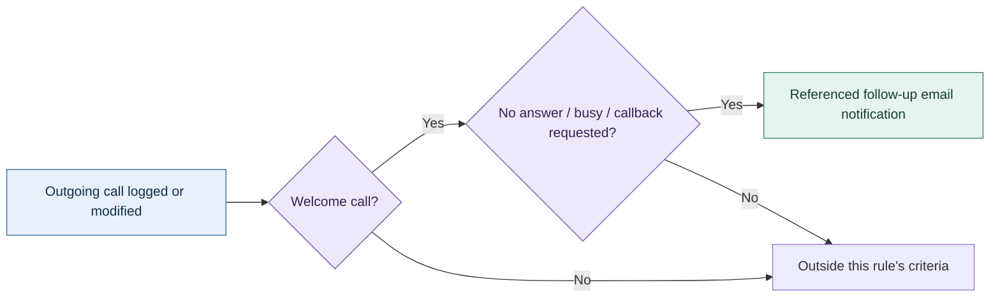

# Expert Solar: systems ownership and preserved history

[Profile](../README.md) · [Systems & operations](OPERATIONS.md) · [Background](BACKGROUND.md)

**Preserved partial history of a previously functional system.** The legacy Zoho account is an aged, incomplete record of the original operation. The former Zoho One environment is closed, and its wider automation setup is unavailable for review. The observations below were collected on October 24, 2026, without changing records or executing workflows.

## The work I owned

My responsibilities included CRM and SaaS administration, user lifecycle and permissions, data migration, operational workflows, internal tooling, and staff support. I took over outstanding development requests that had been handled through an external development contract. After delivery moved in-house, the company discontinued that contract, reducing recurring external development expense by approximately **$20,000 per month** from that point forward.

I also supported the transition from Salesforce to Zoho to reduce platform expense. The recurring development reduction is my reported historical business outcome. CRM storage totals are separate from that reported figure; platform licensing expense also remains outside the estimate.

## What remains visible

| Surviving evidence | What it establishes |
|---|---|
| 35,898 entries across the displayed nonzero storage categories | A substantial retained CRM dataset; includes notes and data in the recycle bin |
| 2,997 Deals entries | Deal records existed; installation status is unverified |
| Current Super Admin designation | Administrative access in the retained organization; this is a CRM role label |
| Sampled record creation/modification attribution | A sampled deal was created by me in December 2024; another carries my modification attribution in January 2025 |
| 206 distinct labels in a sampled Deals layout | A detailed operational schema with standard fields and metadata; authorship of every custom field is unverified |
| 13 retained workflow definitions | Partial configuration history; current execution is unverified |

### An aggregate-only excerpt

This is a direct crop from the account's aggregate storage view. The displayed nonzero categories were Contacts 13,471; Accounts 12,687; Calls 6,337; Deals 2,997; Notes 291; Leads 54; Cases 25; Emails 29; and Tasks 7, totaling 35,898 entries. The snapshot counts CRM records and activities. Customer deduplication and active-user counts were outside its scope. The inspected account displayed a 5,000-record allowance. Its retained historical storage view listed 35,898 entries.

## A surviving follow-up pattern

The retained **Welcome Call No Answer** definition identifies outgoing welcome calls with no response/busy or a requested callback, then references a follow-up email notification. It is a concrete example of translating an operational outcome into a next action.

The diagram reflects the definition preserved in the legacy account. Evidence collection used read-only inspection; records and workflow state remained as found, and call, notification, activation, and execution paths were untouched.

Other surviving definitions cover adders, account/contact checks, state routing, and CRM-side Zoho Flow handoffs. In the current inventory, seven switches were on, six off; twelve rows displayed zero attached actions. The age and incomplete state limit what can be demonstrated today. Account history records a previously functional system; current evidence cannot determine the state of every original workflow.

## Evidence and privacy boundaries

The public case uses operational categories and aggregate counts. Customer names, addresses, contact details, identity documents, amounts, record links, integration secrets, full-record screenshots, and account exports remain private.

The account evidence supports CRM administration and surviving historical work. It provides partial visibility into historical user counts, automation behavior, financial outcomes, security controls, and field authorship. I describe earlier operation from my experience. Current execution of the incomplete legacy stack remains unverified.
