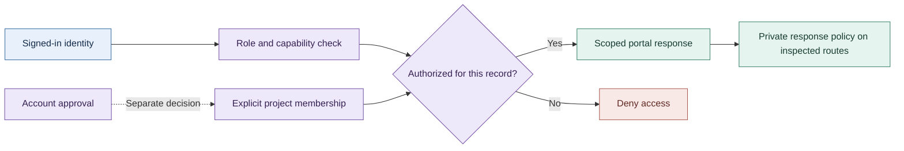
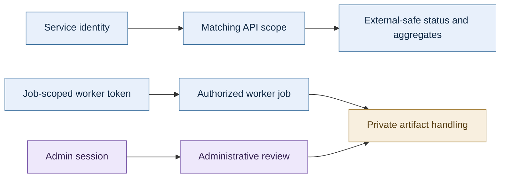
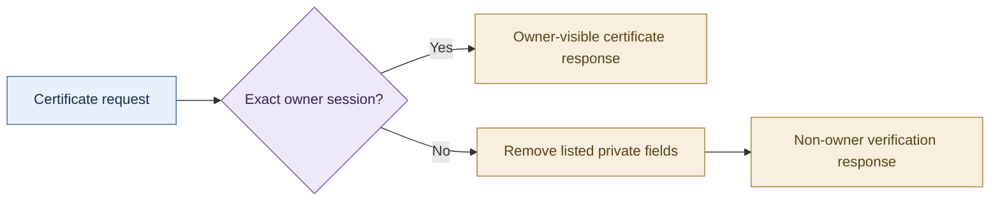

# Security and privacy engineering

[Profile](../README.md) · [Engineering walkthrough](ENGINEERING.md)

Security work in this portfolio is easiest to evaluate through specific decisions: who may act, which records they may see, where credentials live, what a public response contains, and which checks support a release. The diagrams below summarize those boundaries and link to the evidence behind them.

## Portal access is more than a successful login

**305UGC and PowerPortals** distinguish identity, feature access, record scope and project membership. Account approval and project access are separate decisions. Protected changes require both a valid nonce and authorization. CRM OAuth credentials remain in server-side integration components.

**Evidence:** [305UGC security and access practices](https://github.com/RawPowered/305UGC-Showcase/blob/main/docs/SECURITY-PRACTICES.md) and [CRM/automation walkthrough](https://github.com/RawPowered/305UGC-Showcase/blob/main/docs/CRM-AND-AUTOMATION.md).

**Observed scope:** the showcase records private/no-store portal headers, noindex/nofollow and a no-referrer policy on the inspected customer-portal response. Recorded scoped public HTTP checks included anonymous identity denial and crew login redirection. Ordinary-role testing, cross-customer denial, revocation, controlled document release and restore acceptance remain separate requirements. The diagram summarizes the documented architecture. Acceptance evidence for every role and path remains outstanding.

## Different credentials authorize different work

**Dive Deep** documents distinct customer, enterprise, integration, worker and administrator credentials. A worker job token has a dedicated scope, separate from customer and administrator credentials. Its security-boundary notes also separate external-safe status/aggregate fields from internal findings, artifact references, identity fields and operational records.

The source contract also describes outbound-webhook address validation and disabled redirect following to prevent delivery into internal network destinations. These are documented application boundaries. A live-host security assessment remains a separate review.

**Evidence:** [external/internal data and credential matrix](https://github.com/RawPowered/osint-dive-deep-v1/blob/main/web/docs/divedeep-phase9/SECURITY_BOUNDARIES.md), [worker execution contract](https://github.com/RawPowered/osint-dive-deep-v1/blob/main/web/docs/divedeep-phase2/CLOUD_RUN_SECURITY.md), and [complete-stack architecture](https://github.com/RawPowered/osint-dive-deep-v1/blob/main/docs/ARCHITECTURE.md). The earlier worker contract records staged implementation. The later scope matrix describes the design; acceptance of a hosted deployment remains unverified.

## Privacy belongs in the server response

**RawGraded** provides a concrete source example. The public certificate-verification handler checks whether the session belongs to the certificate owner. For a non-owner, it removes a defined set of acquisition fields, tracking/order details, private notes and receipt imagery before returning the certificate response. This server-side output decision protects the response itself and keeps the rule enforceable beyond the interface.

**Evidence:** [verification-handler source](https://github.com/RawPowered/RawGraded/blob/main/public/api/verify.php) and [documented PII/SPII controls](https://github.com/RawPowered/RawGraded#pii-spii-and-data-leak-controls).

**Scope:** source review confirms the explicit removals in this handler. Coverage across all sensitive fields, related endpoints, image responses, and future schema changes remains unverified. Certificate lookup by identifier and authenticated ownership are distinct behaviors in the source. Broader privacy assurance needs its own tests.

## Integration controls and release hygiene

| Work | Reviewable implementation or documentation | Boundary to keep clear |
|---|---|---|
| Flow Fountain machine access | Hashed integration keys, revocation, rate limits and separate operator identity in the [architecture notes](https://github.com/RawPowered/flow-fountain-for-crms/blob/main/content/docs/architecture.md) | Integration keys serve machine access. Human record access requires separate identity and record authorization. CORS controls browser origins; authentication must be enforced separately. |
| Public-source release | Dive Deep's [release policy and checks](https://github.com/RawPowered/osint-dive-deep-v1/blob/main/docs/RELEASE.md) describe packaging boundaries and blank configuration | Hosted installations require separate validation. |
| Automated verification | Public [Fountain CI](https://github.com/RawPowered/flow-fountain-for-crms/actions/workflows/ci.yml) and [Dive Deep verification](https://github.com/RawPowered/osint-dive-deep-v1/actions/workflows/verify.yml) | Automated checks and live integration/security acceptance answer different questions. |
| Portfolio privacy | Fictional or empty demo records, customer data and credentials excluded from public releases, and bounded evidence | Screenshots, diagrams and documentation are labeled according to what they establish. |

These examples document access-control design, server-side data minimization, credential separation, and release checks. Independent penetration testing, universal security guarantees, and regulatory certification fall outside the evidence presented.
